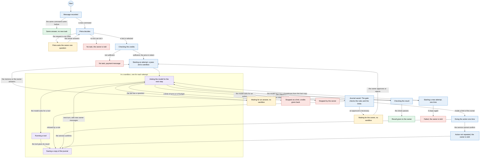

# The architecture of the tensquads platform

Owner: Moe Ghashim. Date: 18 November 2026. Revision 2, after the plan review. This is the reference that the building agent follows for PRD 1.

## 1. How to use this document

Read this document after `docs/PRD.md` and before each task file.

**Authority, from high to low:**

1. The decisions in `docs/PRD.md`, section 4.
2. This document.
3. The plan of Moe, https://tensquads-plan.pages.dev, for behaviour.

If two of them disagree, stop and ask Moe. Do not select one yourself.

**Each section has a mark:**

- **[Fixed]** It comes from a decision. Do not change it.
- **[Proposal]** It is a design that nobody has run. Follow it. If the spike of task 01 or your work shows that it cannot work, stop, show the evidence, and propose a change. Change this document in the same pull request as the code, only after Moe approves.

A design choice that this document does not cover is a question for Moe. A guess that looks right is still a fault.

**Three ideas that each section uses:**

- **Two loops.** The loop of Petra runs on Cloudflare, and Petra is always on. The agent loop of a bot runs in a sandbox. The sandbox is on boat.dev. In this build, a launcher starts the runner as a local process.
- **Two writers.** Petra writes the data of her account. The Platform object writes the data that has no account. No other part writes to the database.
- **Attempts.** Each start of a sandbox for a task is a new attempt. A turn can run again in a new attempt. Each key of each table is made so that this is safe.

## 2. The system in one picture [Fixed]

```
  Test client, demo script, chat          Outside events, hourly cron
            |                                        |
            v                                        v
  +--------------------------------------------------------------+
  | Platform Worker  (apps/platform)                             |
  |  - checks who calls: the identity port, the pass,            |
  |    or the key of the launcher                                |
  |  - gives each call to one of the two Durable Objects         |
  |  - Queue "events": events that do not come from the owner    |
  |  - Queue "jobs": night jobs, checks of tasks and of actions  |
  +--------------------------------------------------------------+
        |  by account id                      |  one fixed name
        v                                     v
  +-------------------------------+   +---------------------------+
  | Petra: one Durable Object     |   | Platform object: one      |
  | for each account              |   | Durable Object            |
  |                               |   |                           |
  |  the loop of Petra            |   |  admin commands           |
  |  gateway, gate, checker,      |   |  accounts, owners,        |
  |  credits, costs, trail,       |   |  unit prices, shared costs|
  |  memory, decisions            |   |  the list of sandboxes    |
  |  writer for her account       |   |  to start                 |
  |  the stream of messages       |   |  the night jobs           |
  +-------------------------------+   +---------------------------+
        |          |        ^                 |          ^
        v          v        |                 v          |
      Neon        R2        |               Neon         |  takes a request
                            |                            |
                            |  gateway calls,     +--------------------+
                            |  with a pass        | Launcher           |
                            |                     | (apps/launcher)    |
                  +------------------------+      +--------------------+
                  | Sandbox: one for each  |               |
                  | attempt                | <-------------+  starts
                  |  runner (apps/runner)  |
                  |  the agent loop of the |
                  |  bot (pi-durable)      |
                  |  the tools             |
                  |  no key, no database   |
                  +------------------------+
```

## 3. The parts

### 3.1 Runtime parts

| Part | Where it runs | Its one job | Mark |
|---|---|---|---|
| Platform Worker | Cloudflare Worker, `apps/platform` | Receives a call, a queue message or a cron tick. Checks who calls. Gives the call to the Petra of the account or to the Platform object. It holds no state, makes no decision and has no database connection | Fixed |
| Petra | One Durable Object for each account. Its name is the account id | Handles the commands of one account, one at a time. Runs her own loop. Hosts the gateway, the gate, the checker, the credits, the costs, the trail, the memory and the decisions. Writes the tables of her account. Serves the stream of messages | Fixed |
| Platform object | One Durable Object with the fixed name `platform` | Handles the admin commands. Writes the tables that have no account. Holds the list of sandboxes to start. Starts the night job of each account. Divides the shared costs. Serves the views | Fixed |
| Launcher | A Node 26 program, `apps/launcher` | Takes each request for a sandbox from the Platform object, and starts one runner process with the pass. It stands in for boat.dev | Fixed |
| Runner | A Node 26 program in the sandbox, `apps/runner` | Runs the agent loop of one bot for one attempt of one task. Calls the gateway for each thing that needs a key, a rule or a write | Fixed |
| Neon | One Postgres database for all accounts | The record | Fixed |
| R2 | One bucket | Drafts of tool files, copies of the journal, and large trail items | Fixed |
| Queue "events" | Cloudflare Queue | Holds an outside event until Petra takes it | Proposal |
| Queue "jobs" | Cloudflare Queue | Holds background work: the night job of an account, a check of a task whose sandbox is silent, a check of an action that is still "started" | Proposal |
| Cron trigger | Cloudflare, one time each hour | Tells the Platform object the time | Fixed |

### 3.2 Packages and plug-ins [Fixed]

Each plug-in is one package and one row in a plug-in list. No plug-in imports another plug-in. There are three plug-in lists: one for Petra, one for the Platform object, one for the runner.

| Package | Runs in | What it provides | What it needs |
|---|---|---|---|
| `core` | All | The cordis core, the plug-in lists, the hook points, the port keys. The only package that imports cordis | — |
| `contracts` | All | The zod 4 schemas: commands, events, the brief, the result, the gateway calls, messages to the owner, the definition of a bot. No code that runs | — |
| `bots` | Petra and the runner | The definition of each bot, as data that passes its schema in `contracts`. In this build: Petra and the test bot | — |
| `loop` | Petra and the runner | The port "run a task". The pi-durable harness. The hook points of section 4. The only package that imports pi-durable | model, journal store |
| `petra` | Petra and the Platform object | The two Durable Object classes. The **account writer** and the **platform writer**, with their readers. The decision sequence of Petra. The only package that calls the write side of the database port | database, object store, queue, identity, decider, model, sandbox |
| `gateway` | Petra | The only door for a sandbox. It checks the pass against the task, then calls the gate, the checker, the costs, the trail and the memory | writer, reader |
| `gate` | Petra | The rules and the limits of the owner, approvals, and "one action, one time" | writer, reader, channel, payment |
| `checker` | Petra | The check of a result: tests by code, then the checker model | checker model, writer |
| `credits` | Petra | The credit check and the ledger rows: what the owner pays | writer, reader |
| `costs` | Petra and the Platform object | One cost row for each thing that we pay for, the price list, the division of a shared cost, the views | writer, reader |
| `decisions` | Petra | The list of decision points, the decision record, the shadow mode | decider, writer |
| `trail` | Petra | One trail row for each step | writer, object store |
| `memory` | Petra | The four layers, forget, undo, search, the night job, the deletion of customer data | writer, reader, model |
| `evals` | Node, in CI and on a developer machine | The case format, the runner, the comparison of two versions | — |
| `link` | Runner | The client of the gateway. It gives the runner its ports: model, journal store, actions, inbox | — |
| `bot-test` | Runner | The plug-in of the test bot: its instructions and its tools. The real bots come later | — |
| `adapters-test` | All | A test adapter for each port that is not real | — |
| `adapters-postgres`, `adapters-neon` | Petra and the Platform object | The two adapters of the database port | — |
| `adapters-cloudflare` | Petra and the Platform object | The real adapters for R2 and Queues | — |
| `adapters-model` | Petra | The real adapter of the model port, for Petra only. The provider and the model are settings | — |

### 3.3 The two writers [Fixed]

- The `petra` package provides an **account writer**. It has one typed method for each kind of write to a table of an account, for example "add a trail row", "start an action", "add a ledger row".
- The `petra` package also provides a **platform writer**, for the tables that have no account: `accounts`, `owners`, `unit_prices`, `shared_costs`, `shared_cost_parts`, `admin_commands`.
- Each other plug-in on Cloudflare calls a writer. It never gets the database port.
- The runner and the launcher have no database port. The Platform Worker has none.
- A test reads each source file and fails if a package other than `petra` calls a write (requirement P2).

**Database roles.** A runtime part connects with one of three roles:

| Role | Who uses it | What it can do |
|---|---|---|
| `ts_petra` | Petra | Read and write the account tables, only the rows of the account that the transaction names. Read the `accounts` and `owners` rows of that account. Read `unit_prices`. No write to a table that has no account |
| `ts_platform` | The Platform object | Read and write `accounts`, `owners`, `unit_prices`, `shared_costs`, `shared_cost_parts` and `admin_commands`. Read the usage view. No access to an account table |
| `ts_admin_views` | The Platform object, for the views | Read the views of the schema `admin`, and nothing more |

The migrations run with the owner role of the database. No runtime part has that role.

**One write is one short transaction.** A command of Petra is not one database transaction. Petra handles a command as a sequence of writes. Each write is one short transaction that names the account, and each write has a natural key, so it can run two times with the same result (section 7.1). If Petra stops in the middle of a command, she runs the command again from its start, and the writes that are already there change nothing.

### 3.4 The pass [Fixed]

A bot reads text from strangers. Thus its sandbox holds no key and no database access.

- For each attempt, Petra makes a **pass**: a signed token with the account, the bot, the task, the attempt number and an end time. The signing key is a secret of the Worker.
- The runner sends the pass with each call to the gateway.
- **The Platform Worker** checks the signature and the end time. A call that fails gets a refusal with no detail, and it does not reach a Durable Object. The Worker takes the account from the pass, never from the body, and gives the call to the Petra of that account.
- **Petra** checks that the task is open, that the bot is the bot of the task, and that the attempt is the current attempt of the task. A call with the pass of an old attempt, or of a task that ended, is refused. A runner that gets this refusal exits.
- The end time of a pass is the maximum time of one attempt (section 10).

### 3.5 The gateway [Fixed]

Each call has the pass and a call number. The runner counts its calls in one attempt: 1, 2, 3. The same call number two times is the same call, and it gets the saved answer.

Each call also has the id of the runner, a random value that the runner makes when it starts. `start` connects the attempt to one runner id. A `start` with a second runner id for the same attempt is refused, and each later call must have the same runner id. Thus one attempt has one runner.

Before the work of a call starts, Petra marks the call number as "in progress". The mark is in memory only, so it goes away if Petra stops. A copy of a call that is in progress gets the answer "busy, try again". If Petra stopped during a call, the copy finds no mark and no saved answer, and the call runs again: each of its writes has a key. Petra saves the answer of each call by its call number, in her storage, until the attempt ends. Petra checks the runner id before she looks for a saved answer.

| Call | What the gateway does |
|---|---|
| `start` | The first call of an attempt. The runner gives its commit and the hash of its plug-in list. The gateway records them, and returns the brief, the forget list of the task, the link to the newest copy of the journal, the draft files that belong to that copy, and each decision of the owner that the runner must deliver as a signal (section 4.4) |
| `model` | Checks the limit of turns and the limit of budget. Calls the model port with the real key. Records one cost row and one trail row. Returns the answer of the model |
| `step` | Records one trail row for a tool use, and one cost row for the time of the sandbox |
| `action` | Gives the request to the gate. Answers "done" with the result, "refused" with the reason, or "wait for the owner" |
| `inbox` | Gives the runner all the messages for this task, each with its source reference, the full forget list of the task, and each decision of the owner to deliver as a signal. The runner gives each message to the loop with the source reference as its request id, so pi-durable drops a message that it already has |
| `journal` | Saves a copy of the journal of the task in R2, and writes one `journal_copies` row before it answers |
| `draft` | Saves a changed file to the draft store, with the attempt and the call number of the save, or returns a draft file |
| `result` | Takes the result, runs the check, and answers "stands" or "continue" with the reason |

The gateway has no other call. No call takes credits: the price of a task is one ledger row, at the start of the task (decision D20).

### 3.6 The launcher and the sandbox port [Fixed]

Petra is a Durable Object. She cannot start a process. This is the path:

1. Petra calls the sandbox port: "start a sandbox for this account, task and attempt, with this pass".
2. The test adapter of the sandbox port gives the request to the Platform object. The Platform object puts it in its list of sandboxes to start.
3. The launcher asks the Platform Worker for the next request, with `POST /v1/launcher/take`. The call waits for a short time when the list is empty. The launcher proves who it is with the key of the launcher, a secret of the Worker.
4. The launcher starts one runner process, with the pass and the address of the Worker as its only inputs.
5. When the runner exits, the launcher reports the exit code with `POST /v1/launcher/report`. The Platform object tells the Petra of that account. Petra uses the report only if it is for the current attempt of a task that has the status "running". A runner that exits on purpose, after "wait for the owner" or after the result, is not a failure.

Rules:

- The list has one request for each task and attempt. A request that a launcher took is never given again. A request that no launcher took stays in the list, and the operations view shows it after the take time (section 10).
- If a launcher took a request and no `start` call came in the silent time, the sandbox did not start. This is not a failure of the task. Petra adds a new attempt with the reason "the sandbox did not start". After three such attempts in sequence, the task gets the status "failed".
- If Petra runs a command again, she sends the request again for each attempt that has no `start`. The list keeps one request for each task and attempt, so a copy changes nothing.
- The list is in the storage of the Platform object. It is not the record. The record of an attempt is its row in `attempts`.
- The launcher stops a runner at the end time of its pass.
- The same launcher runs on a developer machine, in CI, and on the machine that runs the demo against staging.
- Later, a real adapter of the sandbox port calls boat.dev, and the launcher is removed. No other part changes.

## 4. The agent loop of a bot [Proposal]

### 4.1 The hook points

The `loop` package has eight hook points. They are cordis events. The runner calls them from the pi-durable hooks. Most of the work of a hook is one call to the gateway, because the rules, the keys and the writes are on Cloudflare.

| Hook point | When | pi-durable hook | In the runner | On Cloudflare |
|---|---|---|---|---|
| `task/start` | Before the first attempt | — | — | credits: the balance is sufficient, and the price of the task type is taken. memory: the core and the facts go into the brief. petra: writes the task |
| `attempt/start` | Before each sandbox starts | — | — | petra: writes the attempt, makes the pass, asks for a sandbox, and puts a "check task" job in the "jobs" queue |
| `model/before` | Before each model request | `beforeRequest` | Calls `inbox`. Gives each new message to the loop. Removes the text of each fact on the forget list | — |
| the model call | — | the model port | `link` calls `model` | The limits of turns and of budget. costs: one cost row. trail: one row |
| `tool/before` | Before each tool runs | `beforeTool` | The tool is on the list of the bot | — |
| an action tool | — | `execute()` of the tool | Calls `journal`, then `action`. On "done" or "refused", returns the answer of the gate to the model. On "wait for the owner", parks (section 4.4) | gate: the rules, the limits, an approval, one action one time |
| `tool/after` | After each tool result | `afterTool` | Calls `step`. A changed file goes to `draft` | costs: one cost row. trail: one row |
| `turn/end` | After the tool round of a turn | `afterTools` | Calls `journal` | Saves the copy in R2 |
| `answer/check` | When the model answers with no tool request | `onYield` | Calls `result` | checker: tests by code, then the checker model. memory: the result does not use a forgotten fact |
| `task/end` | After the answer stands, or after a stop | the end of the run | The runner exits | memory: stores the proposed facts and notes. credits: gives the credits back after a stop at a limit. trail: the last row. petra: the message to the owner |

Rules:

- A hook does not use the context of the model.
- `tool/before` and `answer/check` can refuse. A refusal goes to the model as the result of the tool or as a message, and the loop continues inside its limits.
- A tool that only reads or computes runs in the sandbox. A tool that sends something out, or that costs money, is an **action tool**. It never calls a service from the sandbox. Its code in the runner is one call to `journal` and one call to `action`. The definition of the bot says which tools are action tools, and the kind of each one: money, public or other.
- **Each action tool is declared `replay: "safe"` in pi-durable.** If the sandbox stops during the call, pi-durable runs the tool again in the new attempt, with the same tool-call id. The gate then gives the saved answer. If an action tool was not declared so, the model would get an "interrupted" error and would ask again with a new id, and the action could go out two times.
- Each other tool declares if it can run again. A tool that only reads can. A tool that cannot gives the model the "interrupted" error of pi-durable.
- When `action` answers "wait for the owner", the action tool parks, the runner saves the journal and exits (section 4.4). A task that waits has no sandbox (requirement L6). "Wait" is never a result that the model gets.
- The first gateway call of a runner is `start`.
- A plug-in that is removed takes its hooks with it (requirement C6).

### 4.2 How a task stops

The loop gives one of these names, and Petra reads the name (requirement L2):

| Name | Meaning | What Petra does |
|---|---|---|
| `success` | The answer passed the check | Gives the result to the owner |
| `question` | The bot needs a fact or a choice | Looks in the memory. If the answer is not there, asks the owner. Then starts a new attempt |
| `waiting` | An action waits for an approval | Sends the approval request. Starts a new attempt after the answer |
| `max_turns`, `max_budget` | A limit of the task type | Tells the owner. The credits go back |
| `error` | An error stopped the loop, or the sandbox stopped. The run failures `interrupted` and `restart_limit` of pi-durable have this name too | Starts a new attempt one time for each task. After a second failure, the task has the status "failed", and Petra tells the owner |
| `cancelled` | The owner stopped the task | Ends the pass. Tells the owner what was done. The credits go back only if no runner made a `start` call for the task |

### 4.3 Attempts and the journal of a task

pi-durable keeps a journal of each step. The runner keeps it in a local SQLite file in the sandbox. A sandbox keeps nothing after it stops, so the journal must leave it.

- The runner sends a copy of the journal file to `journal` at two points: after the tool round of each turn, and before each call to `action`.
- Each copy has one row in `journal_copies`, with its attempt number and its call number. `start` gives the copy with the largest attempt number, then the largest call number. The numbers are compared as numbers, not as text.
- A new attempt gets that copy with `start`, opens it, and calls `resume()`.
- If a sandbox stops during a turn, the work after the last copy is lost and runs again in the new attempt. The model is called again. That call is a real cost, and it gets its own cost row and trail row, with the new attempt number. The rows of the old attempt stay.
- An action cannot go out two times (section 4.4).
- The trail shows both attempts. A view that counts the work of a task counts each attempt.

If the spike shows that these copies are too slow or too large, the second design is a storage for pi-durable that sends each commit to the gateway. Stop and ask before you build it.

### 4.4 The id of an action

- The id of an action is the task id and the id of its tool call in the journal (decision D8).
- The runner saves a copy of the journal before it calls `action`. Thus a new attempt always finds the tool call with the same id. If the sandbox stops before that copy is saved, the gate never got the id, so no action exists.
- The action tool is declared `replay: "safe"` (section 4.1). Thus a call that was cut off runs again with the same id, and the model does not ask for the action a second time.
- The gate keeps the hash of the content of each action. The same id with the same hash is the same action: the gate answers from its row. The same id with a different hash is refused, and the gate adds a trail row. This protects the rule if a model gives a different request in a turn that runs again.
- An approval is for one id and one hash.

**How an action waits for the owner.** pi-durable lets a tool park: the tool returns a sleep on a signal, and the call holds no process.

1. `action` answers "wait for the owner". The action tool returns a sleep on a signal. The key of the signal is the id of the action.
2. The runner saves the journal with `journal`, and exits with the stop name `waiting`. A park is stored in the journal. It is not a call that was cut off, so it does not count for the restart limit of pi-durable.
3. The owner approves or rejects. Petra starts a new attempt.
4. `start` gives the decision to the runner. The runner opens the journal and delivers the signal with the key of the action.
5. pi-durable runs `execute()` of the tool again, with the same tool-call id. It calls `action` again with the same id and content. The gate answers "done" with the result, or "refused" with the reason when the owner rejected.

A question of a bot uses the same mechanism. The tool "ask a question" parks on a signal whose key is the id of the question, and the stop name is `question`. The answer from the memory or from the owner comes back as the result of that tool.

**A pending action that comes again.** If Petra stopped after she wrote the action and before the owner was asked, the action is "pending" and nobody knows. Thus, each time a "pending" action comes again, the gate writes the approval row, the `approval_request` message and the status of the task again, each by its key. A row that is already there does not change.

**Two calls for one action at the same time.** The gate keeps a mark in memory for each action id whose service call still runs. A second call for that id, also from a new attempt, gets "busy, try again". It does not ask the service and does not change the status.

Status of an action:

| Status | Meaning |
|---|---|
| `pending` | It waits for an approval |
| `rejected` | The owner rejected it. Final |
| `refused` | A rule refused it. Final |
| `started` | The gate wrote the row and is calling the service |
| `done` | The service answered. The answer is in the row |
| `not_confirmed` | The service cannot say if the action occurred. The gate does not repeat it. Petra tells the owner |

The promise for an action is "not two times". It is not "exactly one time".

### 4.5 Forget during a task

- When the owner forgets a fact, Petra adds one row to the forget list of each open task whose brief has that fact.
- `start` and `inbox` each return the full forget list of the task, not only the new rows. Thus a new attempt, which opens an old copy of the journal, removes the text again.
- The brief gives each fact as a separate part with the id of its row. Before each model request, the runner removes each part whose id is on the list, and each exact copy of that text in the other messages.
- The check of a result tests that the result does not use a forgotten fact. This test runs on Cloudflare, where the text is.
- The journal copies of the task still have the text. Our code deletes them with the rule of the fact: after 30 days (section 7.7).

### 4.6 The loop of Petra

Petra does not run in a sandbox. Her loop is the decision sequence of the plan, Part 4:

1. The code answers each question that has a number or a rule.
2. The decider port answers a small question about the meaning of a text.
3. The model port answers a question that needs a plan or a text. For an account with the "real" profile on staging, this is a real large model (decisions D24, D30). In all other cases, it is the fake model.
4. The owner answers the rest.

Petra uses pi-durable in her Durable Object for her conversation with the owner, with the pi-durable storage for Durable Objects. Her tools are: start a task, answer the owner, ask the owner, read the memory, tell the status of a task, stop a task. She has no tool that changes the business. The tool "stop a task" does the same as the `CancelTask` command, so the owner can stop a task in the chat. The decision point "is this message for a task that runs" finds the task. If it is not sure, Petra asks the owner which task. Each tool of Petra is declared `replay: "safe"`, and each one writes by key.

**How Petra takes commands:**

1. A command arrives. Petra writes it to `events` with the status "received". This is the first write. Then she answers "accepted".
2. Petra puts the command in her work list, in the storage of the Durable Object, and handles the commands of the list one at a time, in sequence.
3. When a command is complete, its `events` row gets the status "done".
4. A command that arrives two times finds its `events` row. It gets the same answer and does nothing more.

**The alarm.** A Durable Object has one alarm. pi-durable uses it. Petra also needs it for her work list. One handler serves both: it calls `onWake` of pi-durable, continues the work list, and sets the alarm to the earlier of the two next times. Task 01 tests this.

**The conversation of Petra has a maximum age.** At the night job, if the conversation is older than 90 days and Petra is idle, Petra starts a new conversation from the messages in the database, and removes the old one through the interface of pi-durable, never with a direct delete of `pi_` rows. Petra is idle when she has no run, no open question and no tool that is not complete. If she is not idle, the reset waits for the next night.

**Forget in the conversation of Petra.** Petra removes the text of each forgotten fact before each of her own model requests, in `beforeRequest`, as a runner does for a bot.

**A command that runs again.** Petra gives each owner message to her conversation with the command id as its request id, so pi-durable takes it one time. Each row that a command makes has a key from its cause (section 7.1), not from its position. Before Petra asks a decider, she reads the `decisions` row with that key. If it is there, she uses its answer and does not ask again.

**One command, one task.** In this build, one command starts one task or none. The id of the task is the command id. The tool "start a task" writes in this sequence, each write by its key:

1. the task row, with the status "starting";
2. the charge, with the key `task/{taskId}/charge`;
3. attempt 1, with the command id as its `cause_ref`;
4. the request for a sandbox, and the "check task" job.

The task gets the status "running" at the first `start` call. If Petra stops at a step, or loses her storage, she does the steps that are missing for the task of that command. She never makes a second task for one command.

**Check jobs.** Petra puts a "check task" job in the "jobs" queue, with a delay of the silent time, when she writes an attempt. While the task runs, each check puts the next one. Petra puts a "check action" job in the queue, with a delay of the time limit of a tool, when the gate writes "started".

### 4.7 Decisions [Fixed]

A decision point is a place where the system asks a small question about the meaning of a text. Example: "Is this person asking for a refund?"

- All decision points are in one list, in the `decisions` package. Each one has an id, a question, a type (yes or no, choice, score), its options, the harm if wrong, a level, and the path below the level.
- A **decider** answers. It is a plug-in behind the decider port. The first decider asks the model port. The decision model is Jev (decision D25). It comes later, as a second decider, in shadow mode first.
- One call can have several questions. Each answer has a probability.
- **The decider reads, and the code decides.** Our code compares the probability with the level, and applies the rule and the limit of the owner. An answer of a decider alone never starts an action with money or a public action.
- Below the level, or after an answer that is not valid, an error or a timeout, the question goes to Petra, then to the owner.
- **Shadow mode:** a setting names a second decider. It gets the same questions. The system records its answers and never uses them.
- Each answer is one row in `decisions`. What the owner did later is one row in `decision_outcomes`.

### 4.8 Evals [Proposal]

A test proves that the platform obeys a rule. An eval measures how good a bot or a decider is. This build gives the base for evals.

- A **case** is a file: the input, the setup of a test account, the expected outcome and the grader.
- The **runner of evals** (`apps/evals`) plays a case through the real Petra, the launcher and the real runner of a bot, on one machine. The channel and payment ports are in "no outgoing action" mode: they record and send nothing.
- A case runs several times, because a model does not give the same answer each time. The report has the pass rate, the variation, the cost and the time.
- A **version** is the three plug-in lists with their settings. The runner compares two versions on the same cases.
- A case can be made from the trail of a task, only while that trail exists (section 7.7). The function removes each name, address and number of a customer. A case has no customer data, so the deletion rule of section 7.8 does not apply to it.
- The cases and the graders are outside the sandbox. A bot under eval cannot read or change them.

## 5. The path of one task [Proposal]

The example is the fixed demo of the PRD, section 9.

1. **Request.** The test client sends an owner message to the Platform Worker.
2. **Identity.** The Worker asks the identity port for the owner and the account. The account id never comes from the request body.
3. **Command.** The Worker gives an `OwnerMessage` command, with a command id, to the Petra of that account.
4. **Record.** Petra writes the event and answers "accepted". If the command id is already there, Petra gives the same answer and stops (requirement P4).
5. **Decision.** Petra runs her loop. She selects the bot and the task type. Each decision is one decision record and one trail row.
6. **Credits.** `task/start` runs. The credits plug-in refuses the task if the balance is not sufficient. If not, it takes the price of the task type, as one ledger row.
7. **Brief, attempt 1, pass.** Petra writes the task with its brief, and attempt 1. She makes the pass and calls the sandbox port. The launcher takes the request and starts a runner.
8. **Turns.** The runner calls `start`, then starts the agent loop with an empty context and the brief. For each turn: `model/before`, the `model` call, then for each tool request `tool/before`, the tool, `tool/after`, then `turn/end`.
9. **A message during the task.** A second `OwnerMessage` arrives. Petra decides that it is for this task and puts it in the inbox of the task. The runner gets it at the next `model/before` and gives it to the loop as a steer message.
10. **An action above a limit.** The model asks for a refund above the limit. The runner saves the journal and calls `action`. The gate writes the action with the status "pending" and an approval row. Petra sends an "approval request" message. The gateway answers "wait for the owner". The runner saves the journal and exits.
11. **Approval.** An `ApprovalDecision` command arrives. Petra checks that its hash equals the hash of the action, writes the decision, and starts attempt 2 with a new pass.
12. **The action.** The new runner calls `start`, loads the journal and the draft, and continues. It calls `action` with the same action id and the same content. The gate writes "started", calls the payment port, and writes "done" with the answer.
13. **Check.** The model answers with no tool request. The runner calls `result`. If the check fails, the answer is "continue" with the reason, and the loop continues.
14. **End.** `task/end` runs on Cloudflare. Petra stores the proposed facts, writes the last trail row, sends the "result" message to the owner and ends the task. A later call with the pass is refused.

### 5.1 The states of one task [Proposal]

This chart shows the same path as a set of states. The words are what a person can see. GitHub draws the chart from the Mermaid text below. The library Pele (https://pele.run) can draw the same text as SVG with the tensquads colours.

The chart is written by hand from this document. It shows the design. It is not checked against a model, so it proves nothing.



| Colour | Meaning |
|---|---|
| Blue | On Cloudflare, in Petra |
| Purple | In the sandbox, in the runner of the bot |
| Yellow | The task waits for the owner. No sandbox runs |
| Green | The task ended well |
| Red | The task ended with a stop |

## 6. Commands and messages [Proposal]

All schemas are in `packages/contracts`, in zod 4.

### 6.1 Commands to Petra

Each command has these fields: `commandId` (the same id on a retry), `at`. The account comes from the identity of the caller, not from the command.

| Command | From | Other fields |
|---|---|---|
| `OwnerMessage` | The owner | `messageId`, `channel`, `text` |
| `ExternalEvent` | The "events" queue | `eventId`, `source`, `type`, `sender`, `payload`. Its origin is always "not trusted". The channel adapter gives the account and the event id, and the event id is the command id. In this build, the test adapter does this |
| `ApprovalDecision` | The owner | `approvalId`, `decision` (approve or reject), `contentHash` |
| `OwnerAnswer` | The owner | `questionId`, `text` |
| `CancelTask` | The owner | `taskId` |
| `SetRule` | The owner | `rule` (for example: refund, maximum amount) |
| `AddCoreItem`, `RemoveCoreItem` | The owner | `text` or `itemId` |
| `ForgetFact`, `UndoForget` | The owner | `factId` |
| `RunJob` | The "jobs" queue | `job` (night, check task, check action), `localDate` or `targetId` |
| `GrantCredits` | The Platform object | `credits`. In this build, only from `CreateAccount` |
| `ResendSandboxRequests` | The Platform object | None. Each resend has a new command id, made from its time. Petra sends the request of each open attempt that has no `start` |
| `AddCostShare` | The Platform object | `sharedCostId`, `period`, `kind`, `provider`, `amount` (plus or minus) |
| `SandboxExited` | The Platform object | `taskId`, `attempt`, `exitCode` |

A command that an owner sends is valid only if the identity port gives an identity reference, and `owners` has that reference for the account. Petra reads `owners` to check this. A call from a sandbox is not a command. It is a gateway call with a pass.

An `ApprovalDecision` or an `OwnerAnswer` for a task that ended does nothing. Petra answers with a `status` message that says that the task ended.

### 6.2 Admin commands, to the Platform object

Each one has `commandId` and `at`. Only a super admin can send them. The Platform object writes each one to `admin_commands` first. A command id that comes again gets the same answer. An `admin_commands` row has a status: received, then done. When the Platform object starts, it runs each "received" command again from its start, and each step writes by its key. Thus an account always gets its `GrantCredits`, and each account gets its `AddCostShare`.

| Command | Fields | What it does |
|---|---|---|
| `CreateAccount` | `name`, `timeZone` (for example `Asia/Riyadh`), `language` (`en` or `ar`), `modelProfile` (`real` or `test`), `initialCredits` | Adds one `accounts` row. The account id is made from the command id. Then sends one `GrantCredits` command to the Petra of the account, with a command id that is made from this command id. Petra writes the grant row |
| `AddOwner` | `accountId`, `identityRef` | Adds one `owners` row |
| `SetUnitPrice` | `provider`, `model`, `unit`, `price`, `startsAt` | Adds one `unit_prices` row |
| `SetSharedCost` | `period`, `kind`, `provider`, `amount`, `supersedes` (optional) | Adds one `shared_costs` row, then divides the amount (section 7.6) |

### 6.3 Messages to the owner

| Type | When | Main fields |
|---|---|---|
| `reply` | Petra answers in the chat | `text` |
| `question` | Petra or a bot needs a fact or a choice | `questionId`, `text`, `options` |
| `approval_request` | An action needs an approval | `approvalId`, `action`, `content`, `contentHash`, `rule`, `limit` |
| `result` | A task is complete | `taskId`, `summary`, `evidence` |
| `status` | The owner asks what a bot does, or a task stopped | `taskId`, `bot`, `attempt`, `step`, `since` |
| `action_not_confirmed` | A service cannot confirm an action | `taskId`, `actionId`, `what` |

Each message has `seq`, its sequence number in the account, and `at`. No message has a field for layout, colour or a component name (requirement O2).

### 6.4 The brief and the result

- **The brief** has six parts: `goal`, `done`, `facts` (each one a separate part with the id of its row), `limits`, `notInTask`, `replyTo` (the task id).
- **The result** has: `stop` (a name from section 4.2), `answer`, `evidence`, `proposedFacts`, `notes`, `question` (only when `stop` is `question`).

### 6.5 The interface of the Platform Worker

One HTTP interface, with JSON. Each path starts with `/v1`.

| Call | Who can call | What it does |
|---|---|---|
| `POST /v1/commands` | An owner, with a sign-in | Takes one command of section 6.1 that an owner can send. Answers "accepted" with the command id |
| `GET /v1/messages?after={seq}` | An owner | Gives the messages of section 6.3 for the account, with `seq` larger than the number, in sequence |
| `GET /v1/messages/stream?after={seq}` | An owner | A WebSocket. Petra sends each message after the number, then each new message |
| `GET /v1/tasks/{taskId}` | An owner | The status of one task of the account |
| `POST /v1/gateway/{call}` | A sandbox, with a pass | One gateway call of section 3.5 |
| `POST /v1/launcher/take`, `POST /v1/launcher/report` | The launcher, with its key | Section 3.6 |
| `POST /v1/admin/commands` | A super admin | Takes one admin command of section 6.2 |
| `GET /v1/admin/views/{name}` | A super admin | One view of section 7.6, as rows |
| `GET /v1/admin/accounts/{accountId}/tasks/{taskId}/trail?readId={id}` | A super admin | The trail of one task. Petra records the read in `admin_reads`, then returns the rows |

Rules:

- The owner and the account come from the sign-in, through the identity port. A field of the body cannot select a different account.
- A call with no valid sign-in, pass or key gets a refusal with no detail.
- Each error has one form: `code` and `message`. It never has a key, a stack trace or data of a different account.
- **The stream.** The Worker gives the WebSocket to the Petra of the account. Petra accepts it with hibernation, so an open stream does not keep her in memory. Petra sends a message on the stream only after the message is in the database.
- The list and the stream give only the six types of section 6.3. They do not give the messages of customers.
- The list and the stream give the same messages in the same sequence. A client that loses the stream connects again with its last `seq`.

## 7. The data [Proposal]

### 7.1 Rules for all tables

- Each table of an account has `account_id`, and row-level security on it. A transaction of Petra sets the account first. The account comes from the name of the Durable Object, never from a field that a model or a tool wrote.
- **Each write can run two times with the same result.** Each table has a natural key that is made from ids that already exist: a command id, a task id, an attempt number, a call number, a tool-call id. A second write with the same key changes nothing. No table has a random value as its only key.
- **A source reference** is a text key that says where a row came from. Its forms are:
  - `cmd/{commandId}/{what}`: a row from the handling of one command. `{what}` names the cause, never a position: for example `grant`, `reply`, the id of a tool call of Petra, or the id of a decision point with the id of its subject, for example the task that the question is about.
  - `cmd/{commandId}/model/{providerRequestId}`: the cost of one request to a provider in the handling of a command: a model call of Petra, or of a decider. Its `task_id` is empty when the command has no task.
  - `fail/{taskId}/{attemptNo}`: the `cause_ref` of an attempt that follows a failure. The exit report and the silence check of one attempt give the same reference, so one failure adds one attempt.
  - `task/{taskId}/charge` and `task/{taskId}/giveback`: the two ledger rows of a task.
  - `task/{taskId}/{attempt}/{callNo}/{what}`: a row from one gateway call. `{what}` names the kind of the row.
  - `model/{taskId}/{attempt}/{callNo}/{providerRequestId}`: the cost of one request to a provider. A request that really ran two times has two ids, so it has two rows.
  - `shared/{sharedCostId}` and `shared/{sharedCostId}/cancel`: one share of a shared cost, and the row that cancels it.
- No column holds a sum, an average or a percentage. A balance is a query.
- The trail, the ledger and the costs only get new rows. No row changes. A correction is a new row.
- All times are UTC. An account has a time zone. "The same day" and "the night" of an account use that time zone.
- All amounts of money are whole numbers of one millionth of a US dollar. Credits are whole numbers.
- The search columns use the `simple` text search configuration, on text that our code made regular first (requirement M12).

### 7.2 Tables in Neon

Tables with no account. Only the Platform object writes them.

| Table | Natural key | Main columns |
|---|---|---|
| `admin_commands` | `command_id` | `kind`, `payload`, `admin_ref`, `status` (received, done), `answer`, `at` |
| `accounts` | `id` | `name`, `time_zone`, `language`, `model_profile`, `created_at` |
| `shared_cost_parts` | `shared_cost_id`, `account_id` | `usage`, `amount`. All the parts of one shared cost are written in one transaction, before a share is sent. Never changed |
| `owners` | `account_id`, `identity_ref` | `created_at` |
| `unit_prices` | `provider`, `model`, `unit`, `starts_at` | `price` |
| `shared_costs` | `id` (the command id) | `period`, `kind` (storage, database, worker), `provider`, `amount`, `supersedes` (unique, so an amount is corrected one time), `set_by`, `at` |

Tables of an account. Only the Petra of the account writes them.

| Table | Natural key | Main columns |
|---|---|---|
| `events` | `account_id`, `command_id` | `kind`, `payload`, `origin`, `customer_ref`, `status` (received, done), `received_at` |
| `messages` | `account_id`, `source_ref` | `seq` (unique in the account), `direction` (in, out), `channel`, `sender`, `customer_ref`, `type`, `body`, `task_id`, `hidden`, `cleaned_at`, `at`, and a search column. A write that comes again finds its `source_ref` and keeps the first `seq` |
| `tasks` | `id` (the command id) | `account_id`, `command_id`, `bot`, `task_type`, `brief`, `customer_ref`, `status`, `stop`, `created_at`, `ended_at` |
| `attempts` | `task_id`, `attempt_no` | `account_id`, `cause_ref` (unique in the task: the command id that caused the attempt, or `fail/{taskId}/{attemptNo}`), `runner_id`, `reason` (first, after an approval, after an answer, after a failure, the sandbox did not start), `versions`, `started_at`, `ended_at`, `exit` |
| `journal_copies` | `task_id`, `attempt_no`, `call_no` | `account_id`, `blob_key`, `at` |
| `draft_files` | `task_id`, `path`, `attempt_no`, `call_no` | `account_id`, `blob_key`, `at`. `start` gives, for each path, the newest file that is not newer than the journal copy |
| `task_inbox` | `task_id`, `source_ref` | `account_id`, `kind` (message, forget), `body`, `fact_id`, `at` |
| `actions` | `task_id`, `tool_call_id` | `account_id`, `attempt_no`, `tool`, `kind` (money, public, other), `content`, `content_hash`, `status` (section 4.4), `service_ref`, `answer`, `started_at`, `done_at` |
| `approvals` | `task_id`, `tool_call_id`, `content_hash` | `account_id`, `rule_id`, `limit_at_that_time`, `status` (pending, approved, rejected), `decided_by`, `decided_at` |
| `rules` | `account_id`, `command_id` | `kind`, `params`, `active`, `created_by`, `created_at` |
| `ledger` | `account_id`, `source_ref` | `task_id`, `kind` (grant, charge, give back), `credits` (plus or minus), `at` |
| `costs` | `account_id`, `source_ref` | `task_id`, `attempt_no`, `kind` (large model, decider, checker model, sandbox, outside service, storage, database, worker), `provider`, `model`, `units`, `unit`, `unit_price`, `amount`, `divided` (yes or no), `period`, `at` |
| `trail` | `account_id`, `source_ref` | `task_id`, `attempt_no`, `turn_no`, `seq` (given by the database, for the sequence), `kind`, `actor`, `summary`, `data`, `blob_key`, `blob_hash`, `at` |
| `decisions` | `account_id`, `source_ref`, `decider` | `task_id`, `point`, `message_seq`, `options`, `answer`, `probability`, `shadow` (yes or no), `used` (yes or no), `ms`, `at` |
| `decision_outcomes` | `account_id`, `decision_ref`, `command_id` | `outcome` (approved, rejected, changed), `by`, `at` |
| `admin_reads` | `account_id`, `read_id` | `admin_ref`, `task_id`, `at` |
| `notes` | `account_id`, `source_ref` | `bot`, `task_id`, `text`, `origin`, `customer_ref`, `target_page`, `status`, `at` |
| `pages` | `account_id`, `name` | `accepts_from` (a bot or the owner), `created_by` |
| `facts` | `account_id`, `source_ref` | `page`, `text`, `origin`, `made_by`, `customer_ref`, `approved_by_owner` (yes or no), `status` (current, replaced, forgotten), `replaced_by`, `forgotten_at`, `cleaned_at`, `at`, and a search column |
| `core_items` | `account_id`, `source_ref` | `text`, `source` (owner, night job), `fact_ref`, `customer_ref`, `cleaned_at`, `status` (active, removed), `at` |
| `proposals` | `account_id`, `week`, `n` | `kind`, `text`, `evidence` (ids of messages only, never text), `status` (pending, approved, rejected) |

Values:

- `tasks.status`: starting, running, waiting for the owner, done, failed, cancelled.
- `attempts.versions`: the commit of the Worker, the commit of the runner, the hash of each plug-in list, the version of the bot definition, the provider, the model.
- `trail.kind`: owner message, decision, model call, tool use, check, approval, action, refusal, message to the owner, memory.
- `origin`: owner, bot, not trusted, system. The system sets it.

Notes:

- The id of an approval, of a question and of a fact that a message or a command names is its natural key as one text.
- The definition of a bot is not a table. It is data in the `bots` package: its version, its task types with the price and the limits of each one, its tools with the kind of each action, its read list, and the pages that accept its facts.
- Petra tells what a bot does now from the last trail rows of its task. The system stores no second copy of the status (requirement L7).
- The system does not store the current attempt of a task as a column. It is the largest `attempt_no` of the task. A new attempt is added only if no row has its `cause_ref`. Thus a command or an exit report that comes again adds no attempt.

### 7.3 In the Durable Objects

In each Petra:

- The tables of pi-durable for the loop of Petra, with the prefix `pi_`.
- The work list of commands, the counter of `seq` for messages, and the mark "in progress" and the saved answer of each gateway call of each open attempt, with the prefix `petra_`.
- Petra saves the new value of the counter before she writes the message. After a stop, a number can be skipped. A number is never used two times.

In the Platform object: the list of sandboxes to start, and the local date of the last night job of each account, and one marker row. If the marker is not there at a start, the Platform object lost its storage.

**Nothing here is the record.** If a Durable Object loses its storage:

- Petra reads the `events` rows with the status "received", in sequence, and makes her work list again.
- She sets the counter of `seq` from the largest `seq` in `messages`.
- She makes a new conversation from the last messages in `messages` (requirement L14). The old conversation is lost. The messages are not.
- Each open task continues: its record is in `tasks`, `attempts` and R2.
- The Platform object cannot read an account table. It reads the `accounts` rows and sends `ResendSandboxRequests` to each Petra. Each Petra sends the request of each open attempt that has no `start`.

### 7.4 In R2

- Drafts: `accounts/{accountId}/drafts/{taskId}/{attempt}-{callNo}/{path}`. Each save is a new object, so a late call of an old runner cannot change a file of a new attempt.
- Copies of the journal: `accounts/{accountId}/journal/{taskId}/{attempt}-{callNo}`.
- Large trail items: `accounts/{accountId}/trail/{taskId}/{hash}`.
- Each key starts with the account id. A read checks that the account id of the key is the account of the Durable Object.

### 7.5 In the sandbox

- The journal file of pi-durable and the files of the tools, only while the attempt runs.
- Nothing stays after the sandbox stops.

### 7.6 Credits, costs and the views for the team [Fixed]

- **A credit** is what the owner pays. It is a row in `ledger`. A task has one "charge" row with the price of its task type, and one "give back" row in three cases: it stops at a limit, Petra cancels it for a deletion, or the owner cancels it before a runner made a `start` call. The number of attempts and of model calls does not change the price.
- **A cost** is what we pay. It is a row in `costs`, with the account, the task and the attempt.
- `unit_prices` has no account. A new price starts on a date and does not change an old cost row.
- **A shared cost** has no single account: the storage, the database, the Worker. A super admin gives its amount for a period with `SetSharedCost`. The Platform object then:
  1. reads the usage of each account in that period from the usage view;
  2. divides the amount in proportion to the usage. The parts are whole numbers. The remainder goes to the accounts with the largest fractions, and then in the sequence of the account ids, so the sum of the parts equals the amount;
  3. writes the parts to `shared_cost_parts`, before it sends a share. If the command runs again, it reads the parts from that table and does not calculate them again;
  4. sends one `AddCostShare` command to the Petra of each account. Each Petra adds one cost row with `divided` set to yes. The command id is the shared-cost id and the account id.
- **Usage.** The usage of an account in a period is the number of its cost rows in that period that are not divided, of each kind. Cost rows stay, so the number can always be calculated again. If no account has usage in the period, the amount is divided in equal parts between the accounts that existed in the period. Moe confirmed this measure.
- **A correction.** A `SetSharedCost` with `supersedes` names an old row. The Platform object reads the old parts from `shared_cost_parts`. It sends, for each account, one `AddCostShare` with the old part as a negative amount, and one with the new part. The command id of a cancel row ends with `/cancel`. No row changes.
- A period with no amount has no divided rows. The operations view lists it.
- **A task that is stuck**, for the operations view: a task with the status "starting" or "running" that has no trail row for longer than the maximum time of one attempt, or a request for a sandbox that no launcher took in the take time.
- The team reads **views**, in the schema `admin`: for each account, each task type, each bot, each model and each decision point, one usage view, and one operations view. A view calculates its numbers when it is read. A view returns numbers, ids and names of bots, models and task types. It never returns the text of a message, a brief, a fact or an action.
- The views are owned by a database role that row-level security does not limit, and no account table has FORCE ROW LEVEL SECURITY. A runtime role reads a view and never the tables behind it.
- The super admin is a role of the identity port. It can send the four admin commands, read the views, and read the trail of one task. Each read of a trail adds one row to `admin_reads` before the rows are returned. No other admin call exists.

### 7.7 How long data stays [Fixed]

| Data | Time |
|---|---|
| The trail of a task, with its items in R2 | Deleted one month after the task ended. Never deleted for an open task. A trail row with no task is deleted one month after it was written |
| The drafts and the journal copies of a task | Deleted when the task has a final status: done, failed or cancelled |
| A forgotten fact | Hidden from each search and each brief at once. Deleted after 30 days |
| The journal copies of a task whose brief had a forgotten fact | Only the runner of that task can read them, so that the task can continue. The runner removes the text from each model request. Deleted after 30 days |
| A forgotten fact in the conversation of Petra | Removed from each model request at once. Its rows are deleted at the next reset, which can be later than 30 days |
| The `pi_` rows of the conversation of Petra | A new conversation each 90 days, when Petra is idle. The old one is removed through the interface of pi-durable |
| The personal data of a customer of the business | 12 months after the last message of that customer. Section 7.8 |
| Decision records, cost rows, ledger rows, `admin_reads` | They stay. They have ids, never a copy of a text |
| Approval records | They stay. They have the hash of the content, never the content |

**An open task never blocks a deletion.** If a deletion is due and a task that holds the data is still open, Petra does these steps in this sequence:

1. She cancels the task at once: the stop name is "cancelled", and the pass ends. Each later gateway call is refused, so no new action can start. She tells the owner, and the credits go back (requirement T3).
2. Each approval of the task that is "pending" gets the status "rejected", and its action too.
3. If an action of the task is "started", Petra waits until it is "done" or "not confirmed". The deletion runs in the next night job.
4. The deletion runs.

The role of Petra can delete a trail row only through a row-level rule: the task of the row ended more than one month ago.

All deletions of an account run in its night job.

### 7.8 The personal data of a customer [Fixed]

**What it is.** A customer of the business is a person who is not the owner and who sends a message to the business. The personal data of a customer is each text that the customer wrote, the address of the customer on a channel, and each text that a bot or Petra wrote in a task about that customer.

**The customer reference.** When an `ExternalEvent` with a sender arrives, our code makes `customer_ref`: a hash of the account id, the channel and the address of the sender. Petra sets it on the event and on the message. When Petra starts a task from that event, the task gets the same `customer_ref`. Each note and each fact that the task proposes gets it too. A model never sets it.

A message that goes out in a task of a customer gets the `customer_ref` of the task.

**When.** In the night job, Petra finds each `customer_ref` whose newest message is older than 12 months. For each one, she cleans each place of this table.

| Place | What Petra does |
|---|---|
| `messages` | For each message of that customer, and each message that Petra or a bot sent in a task of that customer: sets `body`, `sender` and the search column to empty, and sets `cleaned_at`. The row stays, with its `seq`, so that a decision record still points at a row |
| `events` | Sets `payload` to empty. The row stays |
| `tasks` | Sets `brief` to empty, for each task of that customer. A task that is still open is cancelled first |
| `task_inbox` | Sets `body` to empty, for those tasks |
| `actions` | Sets `content` and `answer` to empty, for those tasks. The hash and the status stay |
| `approvals` | No change. It has only a hash |
| `notes` | Deletes the rows of those tasks |
| `facts` | Deletes the rows with that `customer_ref`. For a row that the owner approved or promoted, it does not delete: our code removes each name, address and number of the customer from `text`, with the same function as for an eval case, and sets `cleaned_at`. The rest of the fact stays |
| `core_items` | For an item that was made from a fact of that customer: the same cleaning of `text`, and `cleaned_at` is set |
| `proposals` | No change to `evidence`, which has ids only. Sets `text` to empty for a proposal that the owner did not approve and that names a message of that customer |
| `trail` and its items in R2 | Already deleted, one month after each task ended |
| Drafts and journal copies in R2 | Already deleted, when each task ended |
| The `pi_` rows of Petra | Already removed, by the 90-day rule |
| `decisions`, `costs`, `ledger`, `admin_reads` | No change. They have no text |
| Eval cases | No change. A case has no customer data (section 4.8) |

After the cleaning, Petra sets `customer_ref` to empty on the rows whose text is now empty. A fact or a core item that stays keeps its `customer_ref` and its `cleaned_at`, so the system can find it and does not clean it again.

## 8. The isolation of accounts [Fixed]

Five barriers, and each one has a test:

1. **The Durable Object.** Its name is the account id. A command for a different account cannot reach it.
2. **The database.** Row-level security returns zero rows of a different account to the role of Petra. The role of the Platform object cannot read an account table.
3. **The object store.** Each key starts with the account id.
4. **The identity.** The account id comes from the identity port or from the pass, never from a request body, a tool argument or a model answer.
5. **The sandbox.** One sandbox serves one attempt of one task of one account. Its pass opens only that attempt.

## 9. Failure and recovery [Fixed]

| Failure | Rule |
|---|---|
| A sandbox stops during a task | The launcher reports the exit, or the check of section 10 finds that the sandbox is silent. Petra starts a new attempt, one time for each task. The runner loads the last copy of the journal and the draft, and continues. The work after the last copy runs again, with new rows |
| A sandbox stops two times | The task gets the status "failed". Petra tells the owner. The credits do not go back |
| No launcher takes a request | The request stays in the list. The operations view shows it after the take time |
| A launcher took a request, and no `start` call comes | After the silent time, Petra handles the attempt as a sandbox that stopped |
| Two runners start for one attempt | `start` accepts the first runner id. Each call with a second runner id is refused |
| An exit report or a silence check comes for an old attempt, or for a task that is not running | Petra ignores it |
| An old runner is still alive after a new attempt started | Its pass is of an old attempt. Each of its calls is refused, and it exits |
| Petra stops in the middle of a command | She runs the command again from its start. Each write that is already there changes nothing |
| Petra stops in the tool "start a task" | The tool runs again. It does the steps that are missing for the task of the command. One task, one charge |
| Petra stops after she wrote an attempt and before she asked for a sandbox | When the command runs again, she sends the request for each attempt that has no `start` |
| Petra stops during a gateway call | The mark "in progress" was in memory and is gone. The copy of the call runs again, with the same keys |
| The Platform object stops in the middle of an admin command | At its start, it runs each "received" command again |
| The Durable Object of Petra loses its storage | Section 7.3 |
| A command arrives two times | The command id finds the first one. One result |
| A gateway call arrives two times | The call number finds the saved answer |
| An action has the status "started" after a restart | The "check action" job takes only an action that is "started" for longer than the time limit of a tool. The gate asks the service. If the service cannot answer, the action gets "not confirmed", only if its status is still "started". It does not run again, and Petra sends `action_not_confirmed` |
| A copy of a gateway call arrives while the first one still runs | The call number is "in progress". The copy gets "busy, try again" |
| Petra stops after a provider answered and before the cost row is written | That one cost is not recorded. This is the only known gap in the cost record. The model is called again, and the second call is recorded |
| An action comes again with a different content | The gate refuses it and adds a trail row |
| A tool hangs | The time limit of the tool stops it. The model gets an error result |
| A task reaches a limit | The task stops with its name. No new action starts. The credits go back |
| The model of Petra fails or is too slow | Petra tries one more time. Then she sends a fixed message to the owner |

## 10. Configuration [Proposal]

- **The plug-in lists:** one file for Petra, one for the Platform object, one for the runner. Each row names one plug-in.
- **The limits of a task type:** maximum turns and maximum budget, in the definition of the bot.
- **The settings of the Worker:** bindings and variables in `apps/platform/wrangler.jsonc`. After a change, run `npm run typegen:cloudflare`.
- **The secrets of the Worker:** the key that signs a pass, the key of the launcher, the three database connections, the key of each model provider.
- **Validation:** each surface checks its settings at the start. A missing setting stops the start, and the message names the setting and never its value.

Times, with their first values. Each one is a setting. Moe can change a value with no change to the code.

| Setting | First value | Used for |
|---|---|---|
| The maximum time of one attempt | 30 minutes | The end time of a pass |
| The take time | 30 seconds | A request that no launcher took is in the operations view |
| The silent time | 2 minutes | A sandbox with no gateway call is handled as stopped |
| The time limit of a tool | 60 seconds | A tool that hangs |
| The time limit of a model call | 60 seconds | Requirement N6 |
| The time limit of a decider | 5 seconds | Requirement Q4 |
| The hour of the night job | 02:00, local time | Decision D31 |

### 10.1 The night job

1. The cron trigger runs one time each hour. The Worker tells the Platform object.
2. The Platform object reads the time zone of each account. For each account where the local time is 02:00 or later on that date, and where no night job was sent for that local date, it puts one `RunJob` message in the "jobs" queue. The command id is made from the account id and the local date.
3. The Worker gives the command to the Petra of the account. A command id that comes again does nothing.
4. In one night job, Petra does these in sequence: the proposals for the core (requirement M10), the deletions that are due (sections 7.7 and 7.8), and a new conversation if hers is older than 90 days and she is idle.

Thus a day with a clock change still has one night job. A Durable Object alarm is not used for this, because pi-durable uses the alarm of Petra.

### 10.2 Where the code runs

| Place | The Worker and the Durable Objects | The database | The launcher and the runner | The model of Petra |
|---|---|---|---|---|
| A developer machine | The local emulator of Cloudflare | A local Postgres | On the same machine | The fake model |
| CI | The Workers test runtime, and the local emulator for the tests of the full path | A Postgres service of CI | In the CI job | The fake model |
| Staging | Cloudflare | Neon | On the machine that runs the demo or the chat | A real model for an account with the "real" profile. The fake model for an account with the "test" profile |

- The database port has two adapters: `adapters-postgres` for a plain Postgres connection, and `adapters-neon`. Both pass the same contract tests, with row-level security and the three roles. The tests of the Neon adapter run in a separate CI job against a Neon branch (requirement V4).
- Task 01 names the database driver that works from a Durable Object in each of the three places.
- One command starts the local system. One command runs the tests of the full path.
- There is no production place in this build.

## 11. What is not proven

Task 01 tests these. Until then, each one is a risk to the sections that the table names.

| Not proven | Affects |
|---|---|
| cordis runs in the Workers runtime and in Node 26 | Section 3 |
| pi-durable and cordis type-check with TypeScript 7 | Section 3.2 |
| The pi-durable storage for Durable Objects works with `onWake`, and our code can use the same alarm | Section 4.6 |
| Our cordis hook points can be called from the pi-durable hooks | Section 4.1 |
| A copy of the journal after each turn and before each action is fast and small, and a new process can continue from it | Section 4.3 |
| After a new process continues, a tool call that was not complete has the same id, and that id occurs one time in the task | Section 4.4 |
| The model layer of pi runs in the Workers runtime | Task 12 |
| One database driver works from a Durable Object to a plain Postgres and to Neon | Sections 3.3 and 10.2 |
| A Durable Object can serve a WebSocket with hibernation while pi-durable uses its alarm | Section 6.5 |
| An action tool that is declared `replay: "safe"` runs again after a kill with the same tool-call id | Sections 4.1 and 4.4 |
| pi-durable has an interface that removes an old conversation | Section 4.6 |
| A tool can park on a signal, the process can exit, and a new process can deliver the signal and get the same tool-call id | Section 4.4 |
| pi-durable drops a message whose request id it already has | Section 3.5 |

## 12. Not in this architecture

These come later. `docs/LATER.md` has the full list. Do not design them now.

- The real sandbox on boat.dev and its image.
- A real model for the bots, the real decision model (Jev), and the real channels.
- The screens of the super admin, and the evals of the real bots.
- The keys of real services, and the limit of the network of a sandbox to permitted hosts.
- The screens, the real sign-in, and the connection to `@tensquads/ui`.
- Prices, packages and the purchase of credits.
- A private store for each account, which the plan names as a later option.
